 
 

## 👋 About me

## 💼 Experience

<table>
<tr>
<td width="150" align="center"></td>
<td><b>T. Rowe Price</b> Equity Investment Risk, working on equity risk and tail risk models</td>
<td align="right" nowrap>London Jun 2026 - Present</td>
</tr>
<tr>
<td width="150" align="center"></td>
<td><b>Aleta Index</b> Part-time Data Scientist at an NLP start-up, researching transformer-based financial sentiment analysis</td>
<td align="right" nowrap>Feb 2026 - May 2026</td>
</tr>
<tr>
<td width="150" align="center"></td>
<td><b>LSE Data Science Society</b> Led a team of 3 developers building a hybrid LSTM / GJR-GARCH framework for realised volatility forecasting</td>
<td align="right" nowrap>Oct 2025 - Feb 2026</td>
</tr>
<tr>
<td width="150" align="center"></td>
<td><b>Bank of America Merrill Lynch</b> Convertible Bonds and Equity Derivatives Analyst</td>
<td align="right" nowrap>c. 2 years</td>
</tr>
<tr>
<td width="150" align="center"></td>
<td><b>Montpensier Finance</b> Buy-Side Equity Analyst</td>
<td align="right" nowrap>c. 6 months</td>
</tr>
</table>

## 🎓 Education

<table>
<tr>
<td width="150" align="center"></td>
<td><b>London School of Economics</b> MSc Operations Research & Analytics Focus: Optimisation Theory, Stochastic Modelling, ML Algorithmic Techniques, Deep Learning and Stochastic Simulation Audit Courses: The Mathematics of the Black and Scholes Theory, Stochastic Processes, The Foundation of Interest Rate and Credit Risk Theory, Advanced Time Series Analysis, Reinforcement Learning</td>
</tr>
<tr>
<td width="150" align="center"></td>
<td><b>Warwick University</b> BSc Management with Finance</td>
</tr>
</table>

## 🚀 Featured projects

<table>
<tr>
<td width="50%" valign="top">

### [Volatility Forecasting](https://github.com/Thomas-F17/Volatility-Forecasting-Stochastic-vs-Machine-Learning-Methods)

Traditional stochastic volatility models vs. LSTM neural networks on Microsoft stock returns (2015-2025). GJR-GARCH tends to outperform the other models in terms of quasi-likelihood loss.

</td>
<td width="50%" valign="top">

### [Quantitative Finance App](https://github.com/Thomas-F17/Quantitative-Finance-App)

A Python application for option pricing via Monte Carlo simulation and Black-Scholes-Merton, plus VaR and CVaR for any stock using historical and parametric (Normal and t) methods.

</td>
</tr>
</table>

## 🛠️ Toolkit

  

  
  
  
  
  
  
  
  

## 📊 GitHub stats

## 📉 VIX snapshot

